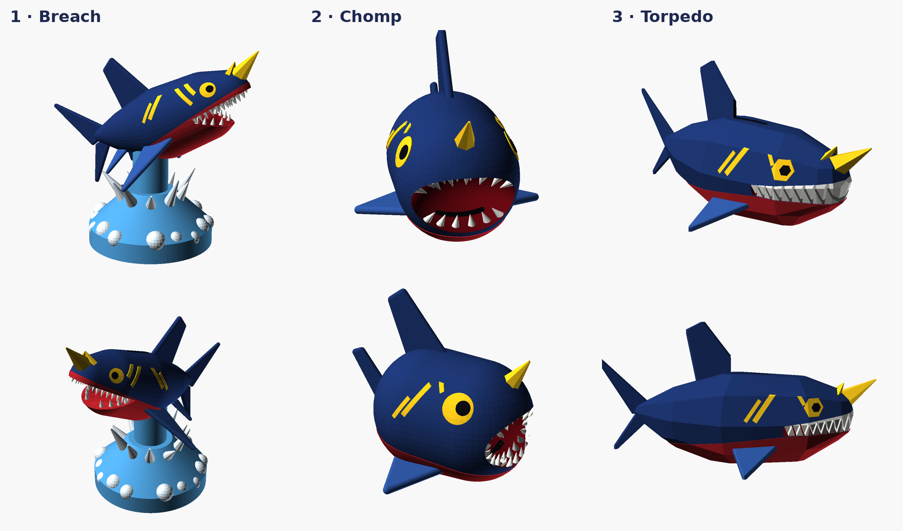

# Mega Sharpedo coin banks

Three 3D-printable coin bank concepts for
[Mega Sharpedo](https://pokemondb.net/pokedex/sharpedo). Each one is a
parametric OpenSCAD model with a coloured preview and a printable hollow shell.



| # | Design | Idea | Coins go in | Coins come out | Size (L × W × H) |
|---|--------|------|-------------|----------------|------------------|
| 1 | **Breach** (`01_breach.scad`) | Shark leaps nose-up out of a splash. The water column is hollow, so coins drop from the body into the wave base. | Slot on the back, in front of the dorsal fin | Twist-lock plug under the base | 207 × 128 × 188 mm |
| 2 | **Chomp** (`02_chomp.scad`) | Chunky chibi head with its jaws wide open and two rows of teeth. | You feed it: the slot is in the floor of the mouth | Twist-lock plug in the belly | 149 × 138 × 127 mm |
| 3 | **Torpedo** (`03_torpedo.scad`) | Low-poly, faceted piggy-bank pose with a jagged grin. Set `FACETS` for a chunkier or smoother look. | Slot on the back | Twist-lock plug in the belly | 227 × 128 × 114 mm |

All three share the Mega Sharpedo details: the yellow nose drill, yellow scar
slashes, yellow eyes, navy upper body with a red lower jaw, and a big dorsal
fin.

## Files

```
lib/bank_common.scad   palette, wall/slot/plug settings, plug + socket
01_breach.scad         design 1
02_chomp.scad          design 2
03_torpedo.scad        design 3
stl/                   ready-to-print shells and the shared plug
renders/               preview images
render.sh              re-render a preview PNG
```

Each `.scad` file has a `part` switch at the top:

- `"preview"` is the coloured model (F5 in OpenSCAD).
- `"bank"` is the printable hollow shell (F6, then export STL).
- `"plug"` is the twist-lock plug. It is the same for all three designs.

## Printing notes

- **Walls:** 2.4 mm (`WALL`). Use 3 perimeters at 0.4 mm nozzle; infill does not matter.
- **Coin slot:** 33 × 4.2 mm. That fits every US, euro and UK coin up to a US half dollar.
- **Plug:** print it cap-down. Line its two lugs up with the notches in the
  floor, push, and turn a quarter turn to lock. If it is loose or tight, adjust
  `PLUG_CLEAR`.
- **Breach:** the body overhangs the column, so use tree supports. The base
  ceiling is 45° and prints without support. The hollow part of the body ends
  right above the column, so coins always slide down into the base.
- **Chomp / Torpedo:** print upright on the flat belly. The top of the inner
  dome is a gentle overhang that most printers bridge. Add supports for the
  fin tips if your printer struggles with them.
- **Colour:** the STLs are a single colour, so paint them, or split the model
  for multi-material printing. The decals in the preview (scars, eyes, red
  jaw) sit 0.5 mm proud of the skin, so they are easy to mask or to export as
  separate bodies.

## Re-rendering

```sh
./render.sh 02_chomp.scad renders/02_chomp_front.png 0,0,45,70,0,80,440
openscad -o stl/02_chomp_bank.stl -D 'part="bank"' 02_chomp.scad
```

The models need OpenSCAD 2021.01 or newer. A full `"bank"` render takes about
1–2 minutes per design.
